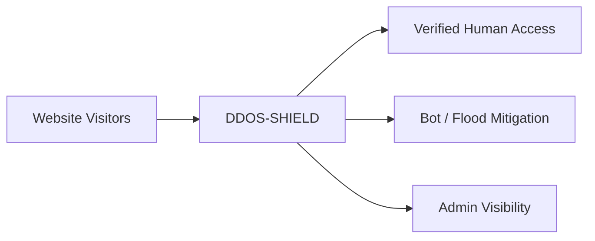
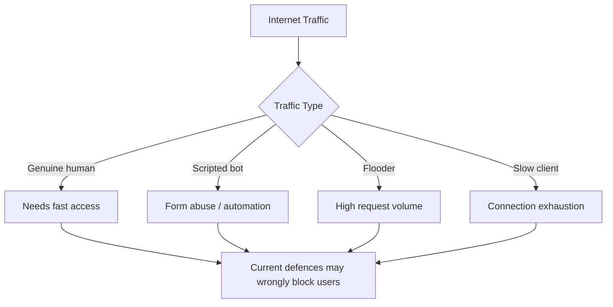
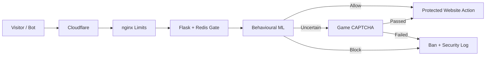
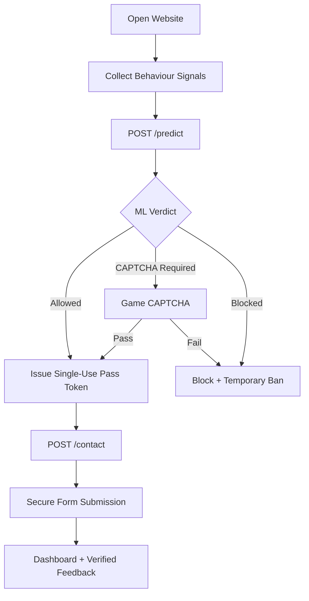
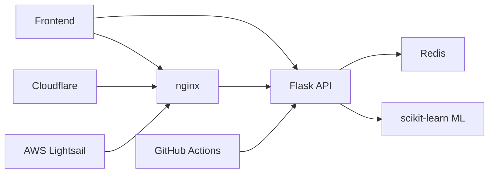
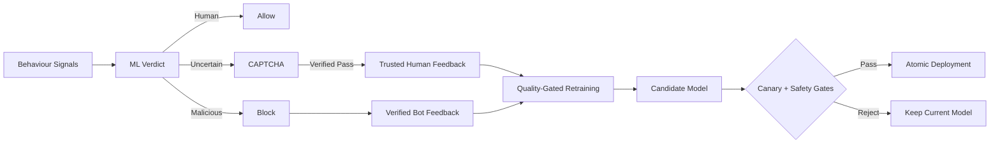
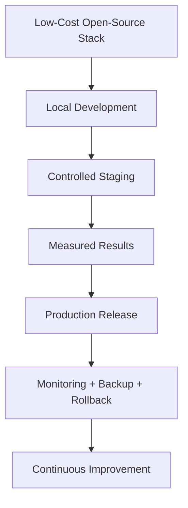
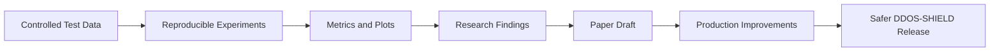

## Slide 1 — Cover Page

**Project Title:**  
DDOS-SHIELD  
AI-Powered Layer 7 DDoS and Bot Protection System

**Tagline:**  
Protecting genuine users through layered security, behavioural intelligence, and safe continuous learning.

**Team Name:** [Your Team Name]  
**Team Members:** [Member Names]  
**College:** [College Name]  
**Problem Statement:** Build a cost-effective system that protects small public websites from HTTP floods, scripted bots, slow-connection attacks, and form abuse without harming genuine users.

---

## Slide 2 — Problem Statement

Small websites are highly exposed to application-layer attacks:

- HTTP request floods can exhaust server resources and make websites unavailable.
- Scripted bots can repeatedly submit forms, scrape content, and abuse public endpoints.
- Slow-connection attacks consume server connections without sending complete requests.
- Traditional rate limiting may block an office, campus, or family sharing one IP address.
- CAPTCHA alone creates friction for every genuine visitor.
- ML systems trained on live traffic can be poisoned by attackers.

**Target users:** Small businesses, student projects, public portals, startups, and community websites.

**Core challenge:** Stop malicious automation while keeping genuine users online.

---

## Slide 3 — Solution

DDOS-SHIELD is a layered Layer 7 protection stack for small web applications.

1. **Cloudflare Edge Layer**  
   Hides the server origin and absorbs large internet-facing traffic.

2. **nginx Protection Layer**  
   Applies request limits, connection limits, body-size caps, and slow-client timeouts.

3. **Flask + Redis Security Gate**  
   Shares rate limits, bans, logs, counters, and security state across workers.

4. **Behavioural ML Engine**  
   Uses browser interaction telemetry to classify traffic as allow, CAPTCHA, or block.

5. **Game CAPTCHA and Pass Token**  
   Validates uncertain visitors and protects the final contact-form action.

6. **Safe Retraining Loop**  
   Retrains only with verified feedback, quality gates, canary testing, backups, and rollback.

---

## Slide 4 — Flow of Solution

**Step-by-step protected user journey:**

1. Visitor opens the contact-form website.
2. Lightweight browser telemetry records only counts and timings, not typing content.
3. On form submission, the system scores behaviour using eight ML features.
4. A normal visitor receives a short-lived, single-use pass token.
5. An uncertain visitor solves the CAPTCHA.
6. A suspicious visitor is blocked and may be temporarily banned.
7. The protected form accepts requests only with a valid pass token.
8. Verified CAPTCHA passes and ML-triggered bans become carefully capped feedback for retraining.

---

## Slide 5 — Technology Stack

| Layer | Technology | Purpose |
|---|---|---|
| Edge Security | Cloudflare | Origin hiding, HTTPS, internet-edge protection |
| Reverse Proxy | nginx | Request limits, connection limits, slow-client defence |
| Backend | Python Flask | API, gate logic, protected routes |
| Shared State | Redis 7 | Rate limits, bans, CAPTCHA state, logs, retraining locks |
| ML Engine | scikit-learn IsolationForest | Behavioural anomaly detection |
| Frontend | HTML, CSS, JavaScript | Contact form, telemetry, dashboard |
| Deployment | AWS Lightsail, systemd | Production hosting and service management |
| Testing | pytest, Playwright, Locust | Unit, browser, integration, and controlled load testing |
| CI Security | GitHub Actions, ruff, pip-audit, gitleaks | Quality, dependency, and secret checks |

**Key performance targets:**

- At least **99% human success rate** during an in-scope single-source flood.
- At most **5% CAPTCHA rate** for genuine users.
- At least **99% naive-bot block or challenge rate**.
- Gate overhead: **p95 ≤ 10 ms** at 100 requests/second.
- ML prediction time: **p95 ≤ 25 ms**.
- Retraining: **under 5 minutes** and **under 400 MB RAM** for 20,000 rows.

---

## Slide 6 — Unique Selling Proposition

### Why DDOS-SHIELD is different

- **Layered defence:** Combines edge, web-server, API, ML, CAPTCHA, and monitoring layers.
- **Human-first approach:** Normal users are allowed quickly; only uncertain behaviour gets challenged.
- **Protected action enforcement:** Bots cannot bypass ML by directly calling the contact endpoint.
- **Privacy-conscious telemetry:** Stores behavioural counts and timings, not keystrokes, form values, or raw IPs in research data.
- **Safe adaptive learning:** Retraining uses only externally verified outcomes.
- **Poisoning resistance:** Per-IP and subnet caps, diversity checks, canary evaluation, threshold-change limits, backups, and rollback.
- **Production-ready operations:** Dashboard, monitoring, CI, test coverage, backups, rollback, and runbooks.

---

## Slide 7 — Feasibility & Competitors

### Feasibility

- Uses a lightweight architecture suitable for a **2 GB AWS Lightsail instance**.
- Relies mainly on open-source tools: Flask, Redis, nginx, scikit-learn, pytest, and Playwright.
- No Kubernetes, managed database, or expensive paid ML infrastructure is required.
- Production deployment is separated from a temporary staging environment.
- AWS snapshots, Redis AOF, model backups, release rollback, and monitoring reduce operational risk.
- Controlled performance testing is limited strictly to infrastructure owned by the project owner.

### Competitor Comparison

| Capability | Basic Rate Limiter | CAPTCHA-Only System | DDOS-SHIELD |
|---|---:|---:|---:|
| Stops repeated requests | Yes | Limited | Yes |
| Detects behavioural anomaly | No | No | Yes |
| Protects direct form submission | Limited | Limited | Yes |
| Reduces CAPTCHA burden for normal users | No | No | Yes |
| Handles slow-client behaviour | No | No | Yes |
| Safe model retraining | No | No | Yes |
| Admin dashboard and rollback | Limited | Limited | Yes |

### Known Scope Limitations

- Does not claim to stop large botnets or multi-Gbps volumetric attacks.
- Does not guarantee detection of attackers using real browsers with convincingly human behaviour.
- Distributed low-rate attacks remain a documented limitation.

---

## Slide 8 — Research & Reference

### Research Deliverables

1. **Feedback Poisoning Resistance**  
   Test whether caps, diversity rules, canary evaluation, and rollback prevent unsafe retraining.

2. **Behavioural Evasion Analysis**  
   Measure how the system responds to safe simulated browser behaviour while protecting genuine users.

3. **Detector and Threshold Comparison**  
   Compare the production IsolationForest approach with research-only alternatives using fixed datasets and canaries.

### Evaluation Evidence

- Human success rate during controlled load.
- CAPTCHA rate and human block rate.
- Naive-bot challenge/block rate.
- Prediction latency and gate overhead.
- Redis, CPU, and memory use.
- Model quality, rollback outcomes, and retraining gate results.

### Project References

- DDOS-SHIELD Product Requirements Document.
- DDOS-SHIELD Production Build Guide.
- GitHub Repository: github.com/Abhinav-Roy-01/DDOS_PROTECTION_SYSTEM_USING_ML
- AWS Lightsail, Cloudflare, nginx, Redis, Flask, and scikit-learn documentation.
- Final demo link: Add after staging and production deployment.

