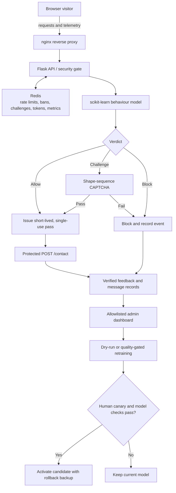

# DDOS-SHIELD

**A local prototype for application-layer (L7) bot and HTTP-flood defense.**
It combines request controls with browser-behaviour scoring, a protected
contact demo, an admin dashboard, and a cautious model-retraining workflow.

> **Scope:** This is not a public deployment or protection against large
> volumetric L3/L4 attacks. The CAPTCHA is a prototype, and sophisticated
> JavaScript-capable or distributed low-rate bots can evade these controls.
> See [limitations](DOCS/LIMITATIONS.md) before relying on or demoing the system.

## How it works



The local stack runs nginx, the Flask/Gunicorn application, and Redis in
Docker Compose. The model scores telemetry from the demo; normal traffic can
receive a pass token, uncertain traffic can be challenged, and suspicious
traffic can be blocked. Retraining uses verified feedback rather than
unconfirmed model predictions.

## PRD-aligned timeline and build order

This is the implementation sequence and current status, not a promised
calendar schedule. The supplied PRD refers to a weekly plan in Section 13,
but that section was not included, so phases are shown without invented dates.

| Phase | Build order | Status |
|---|---|---|
| 0. Foundation | Scaffold, requirements, project decisions, baseline tests | Complete |
| 1. Local infrastructure | Docker Compose, nginx, Redis, Flask/Gunicorn, health checks | Complete for local use |
| 2. ML-backed demo | Bootstrap model, telemetry, verdicts, protected contact, pass tokens, CAPTCHA | Complete for prototype |
| 3. Security controls | Rate limiting, admin allowlist, request protections, bounded feedback | Implemented for local prototype; production integration pending |
| 4. Safe retraining | Verified samples, dry-run, canary gates, backup and rollback | Implemented for local prototype; production scheduling pending |
| 5. Operations and evaluation | Dashboard, controlled load/performance evidence, observability | Dashboard implemented; evaluation remains |
| 6. Release and deployment | Final validation, production identity/TLS, hosting and public URL | Pending |

## Built with

| Area | Tools |
|---|---|
| API and application | Python 3.12, Flask, Gunicorn |
| Detection | scikit-learn IsolationForest, NumPy, pandas |
| Shared state | Redis 7 |
| Web protection and local runtime | nginx, Docker, Docker Compose |
| Demo and dashboard | HTML, CSS, vanilla JavaScript |
| Tests | pytest, fakeredis |
| Source control | Git and GitHub |

The checked-in bootstrap model makes the prototype runnable without first
training a model. Cloudflare, AWS hosting, production TLS/identity, and
public-domain setup are not part of the current local deployment.

## Project map

- `API/` — Flask application, rate limiter, ML integration, and pass tokens
- `DEMO-APP/` and `CAPTCHA/` — browser demo, telemetry, and challenge flow
- `DASHBOARD/` — admin views and controls
- `FEEDBACK/` and `ML/TRAINING/` — verified feedback and retraining workflow
- `INFRA/DOCKER/` — local Compose stack, nginx configuration, and deployment notes
- `TESTS/` — automated tests
- `DOCS/` — decisions, limitations, results, and operational notes

## Run the prototype locally

### Requirements

- Git
- Docker Desktop (Windows/macOS) or Docker Engine with the Compose plugin (Linux)
- Python 3, only to generate random local secrets

### Setup and start

1. Clone the repository and enter it:

   ```sh
   git clone https://github.com/Abhinav-Roy-01/DDOS_PROTECTION_SYSTEM_USING_ML.git
   cd DDOS_PROTECTION_SYSTEM_USING_ML
   ```

2. Create a private environment file. On Windows PowerShell:

   ```powershell
   Copy-Item .env.example .env
   ```

   On macOS/Linux:

   ```sh
   cp .env.example .env
   ```

3. Generate three distinct values:

   ```sh
   python -c "import secrets; print('\n'.join(secrets.token_urlsafe(32) for _ in range(3)))"
   ```

   Put the generated values in `.env`, one per setting:
   `ADMIN_API_KEY`, `PASS_TOKEN_SECRET`, and `FEEDBACK_HASH_KEY`.
   Keep `.env` private; it is excluded from Git.

4. Build and start the local stack:

   ```sh
   docker compose --env-file .env -f INFRA/DOCKER/COMPOSE.yml up --build -d
   ```

5. Open:
   - Demo: <http://127.0.0.1:8090/>
   - Admin dashboard: <http://127.0.0.1:8090/dashboard> — enter the
     `ADMIN_API_KEY` value from `.env`
   - Health check: <http://127.0.0.1:8090/health>

   The app port is bound to localhost; Redis is not published to the host.
   Local Compose trusts its private Docker bridge for admin requests. This
   is a local-development setting, not a production allowlist.

### Stop the stack

```sh
docker compose --env-file .env -f INFRA/DOCKER/COMPOSE.yml down
```

This stops containers and preserves Redis data. To also remove the local
Redis volume and its data, run:

```sh
docker compose --env-file .env -f INFRA/DOCKER/COMPOSE.yml down -v
```

For deployment status and operational caveats, see
[INFRA/DEPLOY.md](INFRA/DEPLOY.md) and [DOCS/DECISIONS.md](DOCS/DECISIONS.md).
